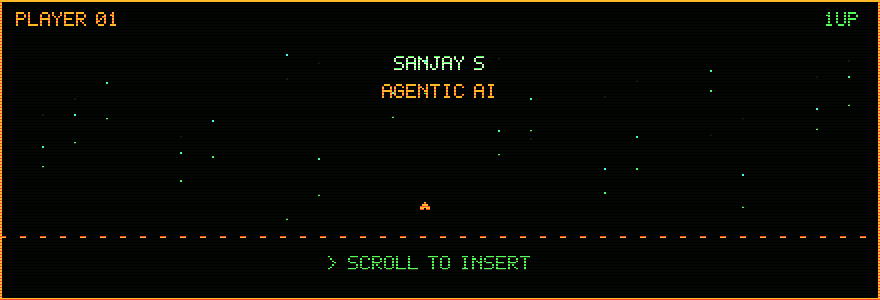
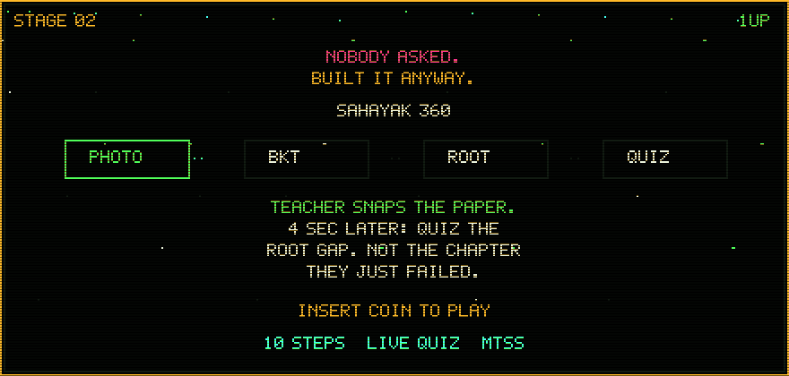
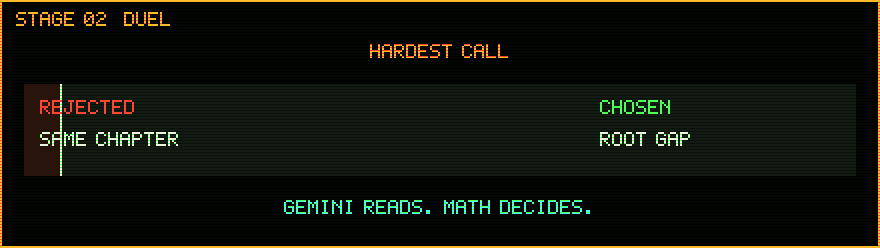
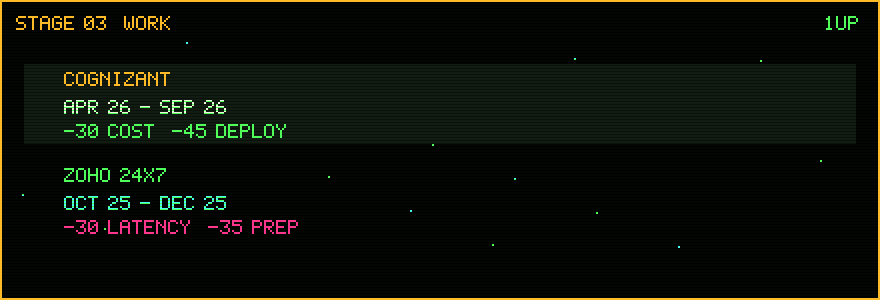
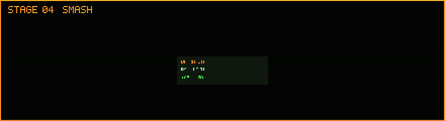

  

## 01 · PLAYER

**SANJAY S**

Agentic AI and DevOps. B.E. Computer Science and Engineering at Chennai Institute of Technology.

| | |
| --- | --- |
| **Base** | Chennai Institute of Technology, Chennai |
| **Program** | B.E. Computer Science and Engineering |
| **Term** | Aug 2024 — May 2028 |
| **CGPA** | 8.18 / 10 |
| **Mail** | [sanjayspmprmuruga02@gmail.com](mailto:sanjayspmprmuruga02@gmail.com) |
| **Phone** | +91 6382130143 |
| **GitHub** | [SanjayS-007](https://github.com/SanjayS-007) |
| **LinkedIn** | Sanjay S |

## 02 · NOBODY ASKED

  

**Sahayak 360.** A teacher photographs a paper test. About four seconds later the student gets a live quiz on the root gap, not the chapter they just failed. Nobody assigned it.

[Play the build](https://sahayak360-mvp.vercel.app/) · [Source](https://github.com/SanjayS-007/sahayak360-mvp)

| Step | What it does |
| --- | --- |
| **Photo** | Gemini reads the sheet. OpenCV cleans it first. |
| **Contract** | Every channel lands in one validated score record. |
| **BKT** | Mastery is a probability, not a percent. |
| **Root** | Neo4j walks prerequisites to the real gap. |
| **Quiz** | WebSocket puts the drill on the student screen. |

  

**Hardest call.** A 60% can be two lucky guesses. More practice on the failed chapter treats the symptom.

| | Rejected | Chosen |
| --- | --- | --- |
| **Score** | Percent correct | Bayesian Knowledge Tracing |
| **Drill** | The chapter on the paper | The weakest prerequisite |
| **Who decides** | The language model | The math. Gemini only reads. |

## 03 · FIELD RECORD

  

### Cognizant Technology Solutions
Agentic AI and DevOps Intern · Apr 2026 — Sep 2026

| Move | Result |
| --- | --- |
| Multi-agent workflows on LangChain, LangGraph, RAG, LLMs, and LiteLLM. Routing, observability, telemetry. | LLM inference cost **−30%** |
| Self-managed Azure platform. Pipelines, virtual machines, serverless Functions. CI/CD automated. | Deploy time **−45%**. Manual effort **−60%** |
| AI services in Docker and Kubernetes. | Same runtime on every release |

### Zoho Corporation, Site24x7
Monitoring and DevOps Engineer Intern · Oct 2025 — Dec 2025

| Move | Result |
| --- | --- |
| Python `.pyz` agent packages for distributed monitoring. | Release preparation **−35%** |
| Profiled execution, telemetry, and metric collection. Cut redundant work. | Monitoring latency **−30%**. Customer compute **−25%** |
| Execution-path debugging across heavy IT estates. | Diagnostic troubleshooting time **−40%** |

## 04 · BUILDS

  

### BharatStat
Agentic statistical reports · Next.js, FastAPI, LangGraph, PostgreSQL, Redis, Neo4j

| Move | Result |
| --- | --- |
| 5-stage semantic pipeline over CSV and XLSX. | Cross-format processing **+65%** |
| 6-stage document pipeline. Figures out of dense PDF templates, publication-ready reports out. | Manual preparation **−70%** |
| Government of India funding for the architecture. Deployed. | **₹1,00,000** |

### Forensic intelligence
Cryptographically enforced · Drain3, Isolation Forest, DuckDB, Parquet, LLMs

| Move | Result |
| --- | --- |
| Autonomous workflow. Log parsing, anomaly detection, threat identification. | **4×** evidence clusters |
| Immutable evidence pipeline. Just-in-time tokens. Explainable calls. | Anomaly F1 **94%**. Analysis time **−55%** |

### CrimeGPT
Legal intelligence · Python, LangChain, Grounded RAG, OCR, vector database, cryptography

| Move | Result |
| --- | --- |
| Unstructured evidence in. Grounded RAG and OCR. | **11** standardized statutory documents |
| Cryptographic signatures and an event-sourced audit log. | Integrity and a full history on every document |
