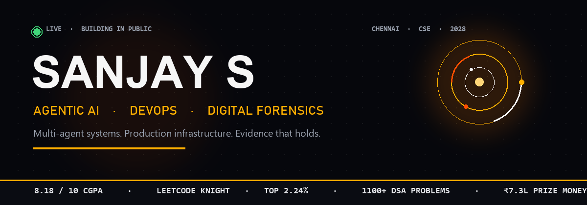

 

 

**B.E. Computer Science & Engineering** · Chennai Institute of Technology · Aug 2024 — May 2028

[Email](mailto:sanjayspmprmuruga02@gmail.com) · [GitHub](https://github.com/SanjayS-007)

 

The job is simple. Take a messy operational problem. Put an agentic system on it. Measure the delta. Ship it again.

I build multi-agent workflows, the infrastructure they run on, and the evidence trail that keeps them honest. Cost, latency, and integrity are the scoreboard.

---

## Operating record

| Where | What moved |
| --- | --- |
| **Cognizant** · Agentic AI & DevOps | LLM inference **−30%**. Deployment time **−45%**. Manual effort **−60%**. |
| **Zoho Site24x7** · Monitoring & DevOps | Monitoring latency **−30%**. Customer compute **−25%**. Diagnostic reliability **+40%**. |
| **BharatStat** · Govt. of India funding | Cross-format processing **+65%**. Report prep **−70%**. **₹1,00,000** captured. Deployed. |
| **Forensic platform** | Anomaly F1 **94%**. Analysis workflows **−55%**. Evidence clusters **4×**. |
| **Arena** | LeetCode **Knight**, rating **2025**, **1100+** problems, **top 2.24%**. **₹7.3L** in hackathon prizes. |

---

## Systems

### BharatStat — agentic statistical intelligence
`Next.js` `FastAPI` `LangGraph` `PostgreSQL` `Redis` `Neo4j`

An AI platform that turns heterogeneous CSV and XLSX into publication-ready statistical reports. Five-stage semantic pipeline. Six-stage document pipeline that pulls precise figures out of dense PDF templates.

**+65%** dataset processing. **−70%** manual preparation. **₹1 Lakh** in Government of India funding for the architecture. Autonomous, real-time, and in operation.

### Cryptographic forensic intelligence
`Drain3` `Isolation Forest` `DuckDB` `Parquet` `LLMs`

An LLM-powered forensic workflow: automated log parsing, anomaly detection, and rapid threat identification across **4×** evidence clusters. The evidence pipeline is immutable. Just-in-time tokens. Cryptographic handling. Mechanisms a human can explain.

**94%** anomaly-detection F1. **−55%** time across analysis workflows.

### CrimeGPT — legal intelligence that leaves an audit trail
`Python` `LangChain` `Grounded RAG` `OCR` `Vector DB` `Cryptography`

Unstructured evidence in. Structured legal intelligence out. The system auto-generates **11** standardized statutory documents, then locks each one with cryptographic signature verification and an immutable event-sourced audit log. End-to-end integrity. Full historical trace.

### Also in the open

[**AEGIS-X**](https://github.com/SanjayS-007/hack-kp-2026) — child-protection investigation platform. HacKP 2026 winner. All case data fictional.

[**Sahayak360**](https://github.com/SanjayS-007/sahayak360-mvp) — educational analytics. Ten-step cognitive pipeline, mastery tracking, and live quiz dispatch.

---

## Where I built it

### Cognizant Technology Solutions — Agentic AI & DevOps Intern
`Apr 2026 — Sep 2026`

- Production multi-agent workflows on LangChain, LangGraph, RAG, LLMs, and LiteLLM Proxy. Agent routing, observability, and telemetry. **LLM inference cost −30%.**
- A self-managed Azure delivery platform: pipelines, virtual machines, and serverless Functions. CI/CD automated end to end. **Deployment time −45%. Manual effort −60%.**
- Highly scalable AI services containerized with Docker and Kubernetes, so every release hits the same runtime.

### Zoho Corporation, Site24x7 — Monitoring & DevOps Engineer Intern
`Oct 2025 — Dec 2025`

- Rebuilt Python `.pyz` agent packages for distributed monitoring. Packaging consistency up. **Release preparation effort −35%.**
- Profiled agent process execution, telemetry handling, and metric collection. Stripped redundant operations. **Monitoring latency −30%. Customer compute overhead −25%.**
- Systematic debugging and execution-path analysis. **Diagnostic reliability and troubleshooting time +40%** across heavy IT estates.

---

## Podiums

| Arena | Result | Scale |
| --- | --- | --- |
| **Statathon 2025** · MoSPI | Winner · 1st | ₹1,00,000 · 5,000+ |
| **HacKP 2026** · Kerala Police Cyberdome | Winner | ₹5,00,000 · 12,000+ |
| **CSIC Innovation Challenge 1.0** · MeitY | Runner-up | ₹80,000 · 3,000+ |
| **HackSetu** · Amity University, MP | Winner · 1st | ₹30,000 · 1,000+ global |
| **Hack-A-Thon 1.0** · St. Peter's, Hyderabad | 2nd | ₹20,000 · 2,000+ |
| **SUVIDHA 2026** · C-DAC under MeitY | Finalist · Top 10 | National field |
| **CYBERHACKATHON v4.0** · Chennai Police Cyber Crime Cell | Finalist · Top 20 | 800+ |

**₹7,30,000** awarded across those rooms.

---

## Competitive programming

| Platform | Rank | Signal |
| --- | --- | --- |
| **LeetCode** | Knight | Max rating **2025** · top **2.24%** globally · **1100+** DSA problems |
| **CodeChef** | 3 Star | Max rating **1410** |
| **Codeforces** | Pupil | Max rating **1020** |

---

## Stack

**Languages** — Python, C++, C, SQL, TypeScript, JavaScript

**AI** — PyTorch, Scikit-learn, OpenCV, NLP, LLMs, RAG, LangChain, LangGraph, Agentic AI, Vector databases, GenAI

**Web** — HTML5, CSS, React.js, Next.js, Flask, FastAPI, Node.js

**Data** — PostgreSQL, MongoDB, Redis, Cassandra, Neo4j, SQLite, Apache Spark, Hadoop, DuckDB, Parquet

**Systems** — Data structures, algorithms, OOP, DBMS, OS, HLD, LLD, computer networks, microservices, API design

**Cloud & DevOps** — AWS, Azure, Docker, Kubernetes, CI/CD, GitHub Actions, Linux, Grafana, Git

**Certified** — AWS Certified Cloud Practitioner · Cisco CCNA, Introduction to Networking · NPTEL Data Science with Python (Elite – Silver) · NPTEL Introduction to IoT & Digital Transformation

---

## Signal

 

 

---

## Field work

**Organiser & Mentor, Hack Fusion Hackathon** — scaled the CSE department hackathon to **1,000+** participants. Mar 2026.

**DSA Bootcamp Instructor** — Data Structures and Algorithms for junior students across five months. 2025.

---

**Building something that has to think, ship, and hold under pressure?**

[sanjayspmprmuruga02@gmail.com](mailto:sanjayspmprmuruga02@gmail.com)

 

